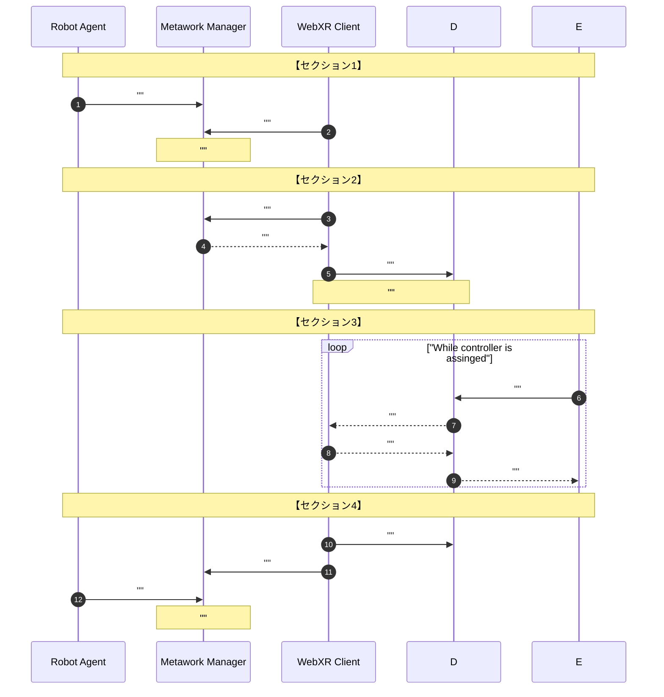
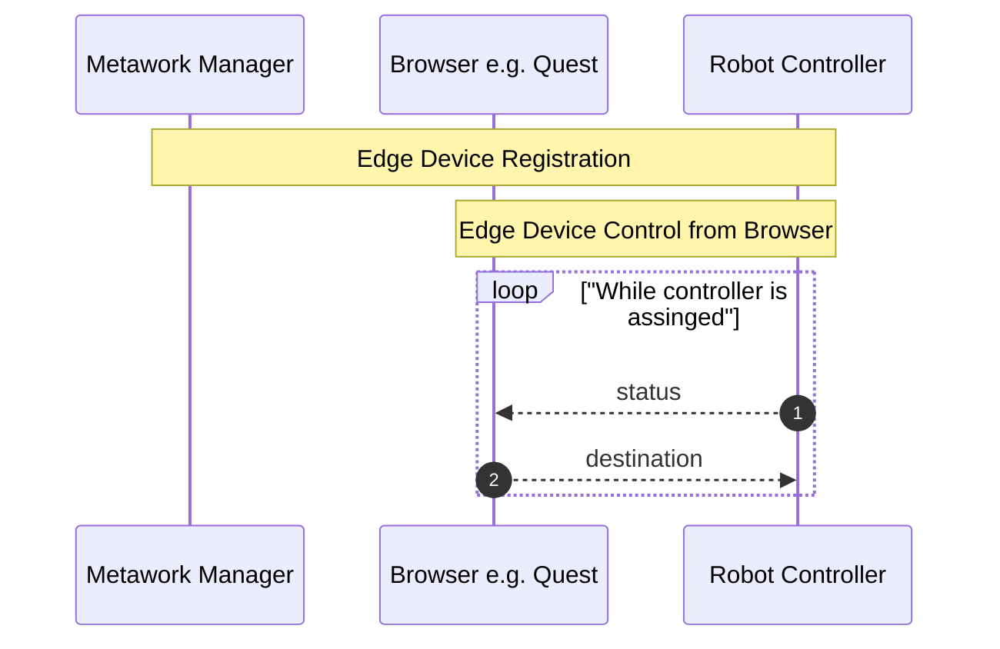

## Topic names and payloads
### Original idea
* notification of acquisition (or lock)
  * name: `dev/${robot_uuid}`
  * payload: `{controler: "browser", devId: "${user_uuid}"}`
* status  
  * name: `robot/${robot_uuid}`
  * payload: `{joints: [j0..j5]}`
* destination  
  * name: `control/${user_uuid}`
  * payload: `{joints: [j0..j5]}`

### Liu's PiPER version
* notification of acquisition (or lock)
  --
* status  
  * name: `robot/${robot_uuid}`
  * payload:  
	* `time`: `time_robot_pub`
	* `state_left`: x
	* `model_left`: y
	* `joint_feedback_left`: j or `joint_feedback`: j
* destination  
  * name: `control/left/joint/${robot_uuid}`
  * payload: `{joint: [j0..j5]}` or `{tool: j0}`
	
### Improved Liu version
* notification of acquisition
  * name: `dev/${robot_uuid}`
  * payload: `{controler: "browser", devId: "${user_uuid}"}`
  
  ただし、left/right,joint/toolで全て同一の`robot_uuid`なため
  4回listenすることになり(動作するが)良くない。
* status  
  * name: `robot/${robot_uuid}`
  * payload:  
	* `time`: `time_robot_pub`(ISO8601 format)
	* `state`: x
	* `model`: y
	* `joints`: `[j0..j5]`
	* `ext`: `left/joint` | `right/joint` | `left/tool` | `left/joint`
* destination  
  * name: `"control/${ext}/${user_uuid}"`  
	i.e. `"control/${arm}/{joint|tool}/${user_uuid}"`  
	e.g. `control/left/joint/843299bc-4c7a-41f7-a2b5-0d00f12ffe25`
  * payload: `{joint: [j0..j5], tool: j0}`  
	`tool`キーの値を使用するか`joint`キーの値を使用するかはsubscriberが決める

1. 同typeのrobotを複数参加させることができ`a-scene`上に複数表示できる
2. Browser側のコードをarm/tool,right/leftで共通化できる。
3. Robot Controller側のコードはright/leftで共通化できる。

# プロトコル改良(ミニマム)案
Metaworkプロトコル全体を変更して良ければ、以下の変更案があります。ただし従来版との
互換性を保つのは難しいかもしれません

1. robot registration時およびrequest時にpropertiy(`left/right/arm/tool`
   その他location等何でも良い)を
   付けられるようにする。requestのgrant(`dev/${user_uuid}`)時に個別のuuidを
   もらい、
   以降uuidでアクセスする(後方互換可: ただし`MetaworkMQTT.py` managerは作り変え)
2. `control`トピックの**トピック名に**`${robot_uuid}`を入れる。
   ロボットはtypeが同一でも自分固有のトピック以外subscribeする必要がなくなる。
   ブローカーが、特定のブラウザーから特定のロボットへのトピックを削除可能になる。
   (オリジナルとの互換困難。ただし劉版で既に非互換となっている)
3. registrationもacknowlege(`registered`)を返す形にして、
   ManagerがUUIDを生成しregisteredでブラウザーおよびロボットに渡す。
   ユーザー認証が簡単になり、セキュリティレベルが上がる。
   Managerはブローカーと組んで、必要に応じて何時でも配信を無効にできる
   (後方互換性確保困難。Manager, 他Clients, Broker設定変更必要)

## Sequence diagrams
**UNDER CONSTRUCTION**

	
